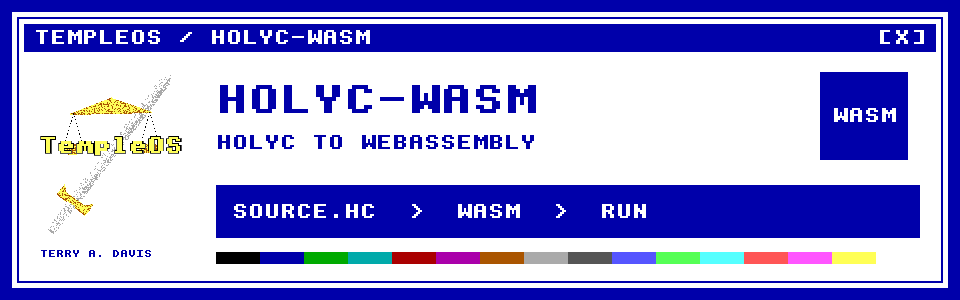

<p align="center">
  
</p>

# HolyC-wasm

**HolyC to WebAssembly.** A compiler and runtime for running HolyC programs in browsers and Node.js.

**[Try the editor in TempleOS-Web →](https://templeosweb.netlify.app/)**

---

<details>
<summary><b>Use the compiler</b></summary>

<br>

From a JavaScript module in this checkout:

```js
import {compileHolyC} from "./src/compiler.js";
import {createHost} from "./src/runtime/host.js";

const {bytes}=compileHolyC('"Hello\n";',{lenient:false});
const host=createHost({ansi:false,onText:text=>process.stdout.write(text)});
const {instance}=await WebAssembly.instantiate(bytes,{env:host.env});
host.attach(instance);
instance.exports.__main();
```

Use `lenient:false` so unsupported symbols and calls produce errors. The older lenient mode can replace them with zeros.

[Compiler and runtime reference](docs/Guide.md)

</details>

---

<details>
<summary><b>What it supports</b></summary>

<br>

The runtime supplies graphics, sound, keyboard input, memory and supported TempleOS APIs. [Apps/HEMU](Apps/HEMU/README.md) supplies the WebAssembly host for [HEMU](https://github.com/ParkerrDev/HEMU)'s HolyC machine; [HolyC-fmt](https://github.com/ParkerrDev/HolyC-fmt) uses it to run its HolyC formatter.

This is a compiler and compatibility runtime, not the TempleOS kernel. Native language behavior is checked against V5.03, but unsupported assembly, hardware and OS behavior remain. A successful compile alone does not establish compatibility.

[Compatibility limits](docs/Guide.md#compatibility-limits) · [Native oracle](docs/Guide.md#native-oracle)

</details>

---

<details>
<summary><b>Development</b></summary>

<br>

```sh
npm test
npm run test:strict
```

Runtime HolyC lives in `Kernel/`, `Compiler/` and `Adam/`. Run `npm run generate`
after editing it; `npm test` also checks that its generated browser module is current.

The tests compare WASM behavior with recorded TempleOS V5.03 results. Reproducing the native oracle also needs its documented QEMU and disk setup.

[Full check list and evidence](docs/Guide.md#checks) · [ABI](src/abi.js)

</details>

---

<details>
<summary><b>Credits</b></summary>

<br>

TempleOS, HolyC, the sword-and-scales artwork and the 8×8 system font were created by **Terry A. Davis**. TempleOS is public domain. The banner uses its font and artwork.

</details>
